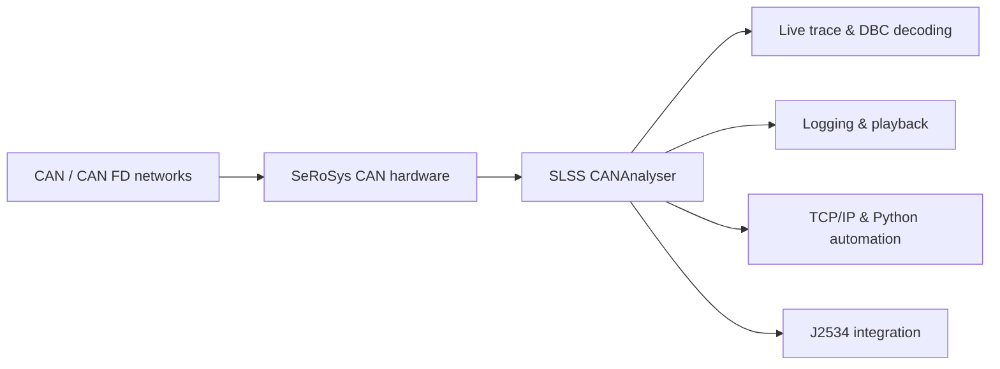

# SLSS CANAnalyser

### Professional CAN & CAN FD Analysis, Logging and Automation

**Powerful bus analysis. Intuitive workflows. Built for engineering.**

[**Product Overview**](https://www.langer-sebastian.de/slss-cananalyser/) · [**Download**](https://serosys-tech.com/downloads) · [**Hardware**](https://serosys-tech.com/shop) · [**Tutorials**](https://serosys-tech.com/instructional-videos) · [**Contact**](mailto:SLSS_Official@langer-sebastian.de)

---

## Overview

**SLSS CANAnalyser** is a Windows-based toolchain for capturing, inspecting, decoding, transmitting and recording **Classic CAN and CAN FD** traffic. Designed for automotive and industrial engineering, it combines a clear live-trace interface with powerful automation and offline analysis capabilities.

Whether you're debugging an individual ECU, recording an entire vehicle test drive, stimulating components or integrating CAN communication into an automated test bench, SLSS CANAnalyser keeps the workflow accessible without sacrificing functionality.

> **From raw CAN frames to meaningful engineering insights — without unnecessary complexity.**

## Highlights

| Capability | Description |
|:--|:--|
| **Dual-channel CAN / CAN FD** | Monitor two independent bus channels simultaneously with compatible SeRoSys hardware. |
| **High-resolution timestamps** | Hardware ecosystem supports timestamps with **1 µs resolution** for timing analysis. |
| **Live trace & filtering** | Search, filter and visually highlight incoming CAN messages. |
| **DBC signal decoding** | Interpret raw payloads as physical values with scaling, offsets and units. |
| **Signal-based transmission** | Transmit DBC-defined signals without manually assembling each payload. |
| **Message transmission** | Send individual frames, configure periodic transmissions and save repeatable sequences as macros. |
| **Logging & playback** | Record bus activity, replay captures and export data for further evaluation. |
| **Offline analysis** | Open and inspect recorded traces without a connected CAN interface. |
| **TCP/IP API** | Control selected CANAnalyser functions remotely and integrate with test automation. |
| **Python integration** | Use a companion Python class for automation and scripted workflows. |
| **J2534 PassThru** | Integrate compatible OEM tools and diagnostic workflows through the available interface. |

## A complete CAN engineering workflow

### Capture and understand

Inspect both CAN channels in a shared live view. Use visual byte highlighting, filters, search and DBC databases to move from raw frame data to interpretable signals and engineering values.

### Transmit and simulate

Send CAN messages manually, set up cyclic transmission and create reusable macros for reproducible tests. DBC-based signal transmission makes it easier to stimulate functions by selecting signals and physical values rather than calculating payload bytes manually.

### Record and review

Capture longer measurement sessions and evaluate the results with offline tools, even when no CAN dongle is attached. Logging, playback and export support development, debugging and test documentation.

### Automate your test bench

Use the **TCP/IP interface** to control key operations from external applications. A companion **Python class** helps integrate CAN traffic, recordings and transmissions into scripted tests. **J2534 PassThru** support provides an additional integration path for suitable diagnostic and OEM workflows.

## Hardware ecosystem

SLSS CANAnalyser is developed in cooperation with **[SeRoSys Technology LLC](https://serosys-tech.com/)** and is designed to work closely with its CAN interface hardware.

Compatible SeRoSys dongles provide, depending on model and configuration:

- Two independent CAN / CAN FD channels
- Switchable bus termination
- Two D-Sub 9 connectors
- Hardware-supported standalone operation
- Persistent storage of up to **40 transmit messages** for standalone use, with configurable startup delays and per-message intervals

**Hardware and purchasing:** [SeRoSys Technology](https://serosys-tech.com/shop) · [European distributor](https://evision-webshop.de/hersteller/serosys/can-analyzer-exerciser-logger)

## Getting started

1. **Get the software:** Visit the [official download center](https://serosys-tech.com/downloads).
2. **Connect your interface:** Attach a supported CAN dongle and connect the required bus channel(s).
3. **Configure the bus:** Select the correct CAN or CAN FD bitrates and interface settings.
4. **Start monitoring:** Connect to the hardware and inspect messages in the live trace.
5. **Explore advanced features:** Import a DBC database, transmit signals, record traces or connect external automation scripts.

**Video tutorials:** [SeRoSys instructional videos](https://serosys-tech.com/instructional-videos) cover the first CAN transmission, scripting and more.

## Typical applications

| Automotive development | Laboratory & production | Diagnostics & automation |
|:--|:--|:--|
| ECU development and validation | Test-bench integration | Automated test sequences |
| Vehicle network debugging | End-of-line testing | Remote CAN control |
| Bus tracing and signal analysis | Long-duration logging | OEM tool integration via J2534 |
| Component stimulation | Reproducible test workflows | Python-driven analysis |

## Licensing

A **lifetime software license** is included with the purchase of eligible SeRoSys CAN hardware, with **no recurring subscription fees** according to the official product information.

An **education program** also supports students and pupils using supported open-source hardware platforms such as Arduino, ESP8266 and ESP32 with appropriate CAN boards. Contact SLSS for current eligibility and setup details.

> **Repository notice:** Availability of code in this repository does not automatically imply that the complete SLSS CANAnalyser application is open source or licensed for unrestricted redistribution. Refer to the repository's license files and official software terms for the applicable rights.

## Documentation and links

| Resource | Link |
|:--|:--|
| Official product page | [SLSS CANAnalyser](https://www.langer-sebastian.de/slss-cananalyser/) |
| Software downloads | [SeRoSys Download Center](https://serosys-tech.com/downloads) |
| Video guides | [Instructional Videos](https://serosys-tech.com/instructional-videos) |
| CAN hardware | [SeRoSys Technology](https://serosys-tech.com/) |
| DBC signal transmission article | [DBC Send Feature](https://www.langer-sebastian.de/senden-von-signalen-aus-dbc-botschaften/) |
| Contact | [SLSS_Official@langer-sebastian.de](mailto:SLSS_Official@langer-sebastian.de) |

## About SLSS

**Sebastian Langer Software Solutions UG (haftungsbeschränkt)** develops engineering software and electronic solutions with a focus on automotive communication, CAN analysis and practical test automation.

SLSS CANAnalyser is developed in cooperation with **SeRoSys Technology LLC**, combining software and dedicated hardware to make sophisticated bus analysis approachable and effective.

---

**SLSS CANAnalyser** · *Because smart solutions matter.*

[Website](https://www.langer-sebastian.de/) · [Product](https://www.langer-sebastian.de/slss-cananalyser/) · [SeRoSys](https://serosys-tech.com/) · [Contact](mailto:SLSS_Official@langer-sebastian.de)

© 2026 Sebastian Langer Software Solutions UG (haftungsbeschränkt)

